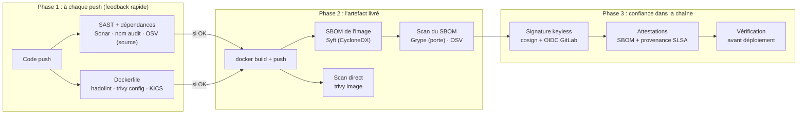

# Lab DevSecOps : de l'image Docker à la chaîne d'approvisionnement signée

> **Scénario à réaliser en autonomie, dans votre propre projet GitLab** (`pipeline-XX-CICD-<initiales>`).
> Ce lab prolonge le TP *« Mise en pratique GitLab CI »* là où nous l'avons laissé : après
> l'intégration de Sonar (étape 5). Vous complétez vous-même les blocs `# TODO`. La correction
> complète se trouve dans [`solution/`](solution/) : ne la regardez qu'en cas de blocage 😉.

## 🎯 Niveau et prérequis

| | |
|---|---|
| **Niveau visé** | débutant à intermédiaire en DevSecOps |
| **Vous savez déjà** | écrire un `.gitlab-ci.yml` avec `stages`, `image`, `script`, `artifacts`, `cache`, `rules`, `extends` et `variables`. Vous avez lancé `npm audit`, `osv-scanner` et Sonar dans votre pipeline (étapes 0 à 5 du TP). Vous savez ce que font `docker build` et `docker run`. |
| **On ne suppose PAS** | les builds Docker multi-stage, le registry de conteneurs, docker-in-docker, les ancres YAML, les SBOM, la signature, OIDC, SLSA ou le langage de politiques Rego. Tout cela est expliqué au moment où on en a besoin. |
| **Matériel** | votre projet GitLab sur gitlab.com (runners partagés) et un navigateur (le Web IDE suffit). Docker sur votre poste est **facultatif** : il sert seulement aux blocs *« 💡 Tester en local »*. |

## 🗺️ Où va-t-on ?

Jusqu'ici, votre pipeline n'analysait que **les sources** : le code avec Sonar, et les
dépendances déclarées dans `package-lock.json` avec npm audit et OSV-Scanner. Or ce que vous
déployez en production n'est pas un dossier de sources : c'est une **image Docker**. Elle contient
votre code et vos dépendances, mais aussi tout un système Debian et un runtime Node.js. Le lab
fait donc entrer cette image dans le périmètre de sécurité, en deux parties :



La phase 1 donne un retour rapide au développeur, sur ce qu'il vient de pousser. La phase 2
analyse **l'objet réellement livré**, ce qui fait apparaître des risques invisibles depuis les
sources. La phase 3 garantit que l'image déployée est bien **celle que le pipeline a construite
et analysée**, et pas une image substituée entre-temps.

## 📚 Les deux parties

| Partie | Étapes | Ce que vous construisez |
|---|---|---|
| [**Partie 1 : Image, scans et SBOM**](partie-1-image-sbom.md) | 6 à 9 | Conteneuriser l'app, comparer 3 scanners de Dockerfile, publier l'image dans le registry GitLab, comparer *scan de dépendances*, *scan d'image* et *SBOM*, puis mettre une « porte » qui bloque les vulnérabilités critiques. |
| [**Partie 2 : Sécurité du pipeline**](partie-2-securite-pipeline.md) | 10 à 13 | Signer l'image sans clé (cosign + OIDC), attester le SBOM et la provenance SLSA, vérifier avant de déployer, vérifier les outils qu'on télécharge (`slsa-verifier`), et se protéger de l'empoisonnement de pipeline (PPE). |

## 📁 Contenu du dossier

Le dossier `lab/` contient trois choses : les guides que vous suivez, les fichiers que vous
copierez dans votre projet, et la correction.

```
lab/
├── README.md                       # ce sommaire
├── partie-1-image-sbom.md          # étapes 6 à 9
├── partie-2-securite-pipeline.md   # étapes 10 à 13
├── assets/etape6/                  # fichiers fournis pour l'étape 6 (app Express + Dockerfile initial)
├── assets/etape9/                  # package-lock.json corrigé (étape 9.6, pour qui n'a ni Node ni Docker)
└── solution/                       # la correction complète (en dernier recours)
    ├── .gitlab-ci.yml              # pipeline final, toutes étapes
    ├── Dockerfile  .dockerignore   # Dockerfile durci (étape 7)
    ├── Dockerfile.distroless       # variante bonus (étape 9)
    ├── package.json  package-lock.json   # dépendances (lockfile corrigé à l'étape 9.6)
    ├── policy/provenance.rego      # politique de vérification (étape 11)
    └── CODEOWNERS                  # relecture obligatoire des fichiers sensibles (étape 13)
```

## 🧰 Versions des outils utilisées (et validées)

Tous les jobs de ce lab ont été exécutés avec ces versions. Elles sont **épinglées** volontairement :
on en reparle à l'étape 12 (« ne jamais utiliser `:latest` ou `edge` »).

| Outil | Rôle | Image / version |
|---|---|---|
| Hadolint | linter de Dockerfile | `hadolint/hadolint:v2.15.1-alpine` |
| Trivy | scanner « tout-en-un » (config, image, SBOM) | `aquasec/trivy:0.75.0` |
| KICS | scanner IaC (Dockerfile, K8s, Terraform…) | `checkmarx/kics:v2.2.0` |
| Syft | générateur de SBOM (image) | `anchore/syft:v1.54.1-debug` |
| cdxgen | générateur de SBOM (sources) | `@cyclonedx/cdxgen@12.8.5` (npm) |
| Grype | scanner de SBOM | `anchore/grype:v0.120.1-debug` |
| OSV-Scanner | scanner (sources, SBOM, image) | `v2.6.0` (binaire vérifié par SLSA) |
| Cosign | signature / attestations | `ghcr.io/sigstore/cosign/cosign:v3.1.3-dev` |
| slsa-verifier | vérification de provenance SLSA | `v2.7.1` |
| Docker | build de l'image (docker-in-docker) | `docker:28.3.2` + `docker:28.3.2-dind` |

> ℹ️ Les nombres de vulnérabilités cités dans le guide ont été relevés le **29/10/2026**. Les bases
> de vulnérabilités évoluent tous les jours : vos chiffres seront différents, mais les **ordres de
> grandeur** et les **conclusions** restent valables. C'est d'ailleurs un des arguments en faveur
> des SBOM (étape 9.7).
